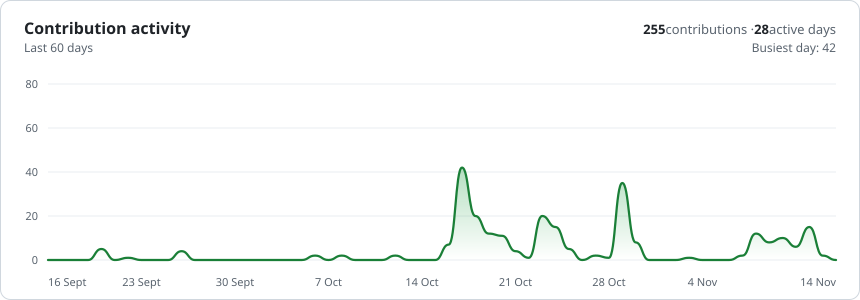
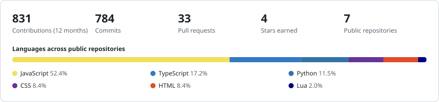

**Web applications · APIs · Automation · System tools**

[Portfolio](https://t91a60.github.io/NikodemBoryczka/) · [GitHub Projects](https://github.com/t91a60?tab=repositories) · [Credly](https://www.credly.com/users/nikodem-boryczka/badges/credly)

<picture><source media="(prefers-color-scheme: dark)" srcset="https://raw.githubusercontent.com/t91a60/t91a60/output/stage-dark.svg?v=2"></picture>

<a href="https://github.com/t91a60?tab=repositories"><picture><source media="(prefers-color-scheme: dark)" srcset="https://raw.githubusercontent.com/t91a60/t91a60/output/row-about-dark.svg?v=2"></picture></a>

<a href="https://t91a60.github.io/NikodemBoryczka/"><picture><source media="(prefers-color-scheme: dark)" srcset="https://raw.githubusercontent.com/t91a60/t91a60/output/row-projects-dark.svg?v=2"></picture></a>

<a href="https://www.credly.com/users/nikodem-boryczka/badges/credly"><picture><source media="(prefers-color-scheme: dark)" srcset="https://raw.githubusercontent.com/t91a60/t91a60/output/row-certs-dark.svg?v=2"></picture></a>

<picture><source media="(prefers-color-scheme: dark)" srcset="https://raw.githubusercontent.com/t91a60/t91a60/output/activity-dark.svg?v=2"></picture>

<picture><source media="(prefers-color-scheme: dark)" srcset="https://raw.githubusercontent.com/t91a60/t91a60/output/overview-dark.svg?v=2"></picture>
